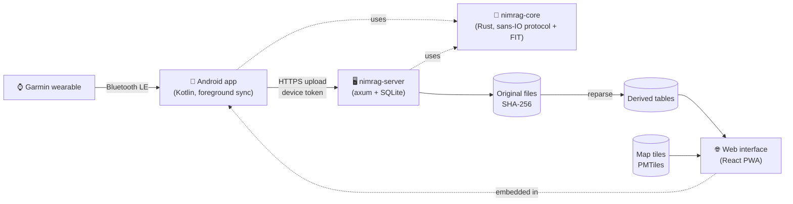
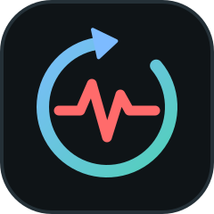

<p align="center">
  
</p>

<p align="center">
  
  
  
  
  
  
</p>

<p align="center">
  <a href="#why">Why</a> ·
  <a href="#how-it-works">How it works</a> ·
  <a href="#roadmap">Roadmap</a> ·
  <a href="#getting-started">Getting started</a> ·
  <a href="#principles">Principles</a> ·
  <a href="#ai-assisted-development">AI-assisted</a> ·
  <a href="docs/protocol/PROTOCOL.md">Protocol notes</a>
</p>

---

**Nimrag Connect** is a self-hosted replacement for the Garmin Connect app and cloud. An Android app talks to your Garmin wearable over Bluetooth LE, pulls every file it records, and sends them to a server you run. The server keeps the originals untouched and turns them into your own dashboards, in the browser and inside the app. No Garmin account, no cloud, no third party in the middle.

## Why

- **Your data stays yours.** Activities, sleep, heart rate and the rest go from your wrist to your server, and nowhere else.
- **Originals first.** Every file from the watch is stored byte for byte, addressed by its SHA-256. The database is only a view, and you can rebuild it from the files at any time.
- **Nothing made up.** Nimrag Connect shows what the watch measured and computed. If a metric isn't in the files, it says *unavailable* instead of estimating it.
- **Built from evidence.** The Bluetooth protocol was mapped from our own captures and static analysis, and every finding is labelled *seen*, *inferred* or *unknown*.

## Highlights

| | |
| --- | --- |
| ⌚ **Direct watch sync** | Our own implementation of the watch link (multi-link, reliable transport, file transfer). Files are only marked as synced on the watch once the phone has stored them safely. |
| 🗄️ **Content-addressed store** | Idempotent uploads, a SHA-256 file store with sidecars, and `reparse` to rebuild every table from the originals. |
| 🧬 **Lossless FIT decoding** | Keeps every message and field, including unknown and manufacturer-specific ones, with their raw bytes. |
| 📈 **Health and training data** | Activities, laps and GPS tracks, strength sets, all-day heart rate, stress, steps, breathing, SpO₂, sleep, HRV, training load and recovery. |
| 📱 **Android app** | Pairs with the watch without the Garmin app, syncs in the background (every 15 minutes by default), keeps an upload queue that survives restarts and bad networks, and shows the web interface inside the app. Sign in once, then unlock with your fingerprint. |
| 🌐 **Web interface** | Today, activities, sleep, HRV, stress, energy, heart rate, training status and load, calendar, strength and body pages, with a detail page per metric (day, week, month and year). Works in any browser and as a PWA. |
| 🗺️ **Maps without a map service** | Activity routes are drawn on a street map served by your own server from a [PMTiles](https://docs.protomaps.com/pmtiles/) file. No tile requests leave your network. |
| 📦 **Bring your history** | Imports a Garmin data export, nested zips and all, through the same path as live uploads, and your Garmin Connect history (daily summaries, stress, heart rate and breathing through the day, sleep, HRV, training, activities with routes) so the pages have data from before you switched. The watch's own files always win over imported data. |
| 🏃 **Workouts and phone features** | Build workouts on the web (steps, repeats, heart-rate, pace and cadence targets) and the phone sends them to the watch. The phone can also show its notifications on the watch, let the watch control music, and ring when the watch asks. Everything is off until you switch it on. |
| 👥 **Accounts** | Several users on one server, each with their own data. Sign-in with password and two-step codes (TOTP); an admin account sets the server up. |
| 🔒 **Built to run at home** | A single Rust binary with SQLite, meant to sit behind your own VPN. Scheduled backups, a restore command, and a zip of all your data on request. |

## How it works



One Rust crate, `nimrag-core`, holds the watch protocol and all FIT decoding. It is *sans-IO*: bytes go in, and bytes and events come out. The server links it directly, and the Android app calls it through Kotlin bindings generated with UniFFI, so there is exactly one implementation of the protocol and one of the parsers.

## Roadmap

| | Phase | State |
| --- | --- | --- |
| ✅ | **0. Protocol map:** static analysis and live Bluetooth captures, decoded end to end | Done. Night-sync and fresh-pairing captures still to record. |
| ✅ | **1. Server:** ingest, file store, FIT decoding, parsers, `reparse`, export importer | Done. Gate passed on a full USB copy of a watch. |
| 🚧 | **2. Android sync:** protocol client, Android app, upload queue, companion duties, Garmin device support ported from Gadgetbridge | The app pairs, syncs and uploads, and has synced an Instinct 2 every 15 minutes since November 2026. It can also run alongside the Garmin Connect app. Notifications on the watch, music control and find my phone are built (off until switched on) and await a test on a real watch. Still to do: GPS assist and weather, forwarding to Garmin Connect, and the rest of the Gadgetbridge device catalogue. |
| 🚧 | **3. Web interface:** Today, activities, sleep, trends, training, calendar and more | The pages, accounts, maps and the app shell are built and in daily use. Every page passes an automated accessibility check (axe, keyboard, 200% zoom) on sample data. Still to do: the same review on real data, and offline viewing on the phone (an experiment for now). |
| 🚧 | **4. Writing and operations:** workouts to the watch, backups, export, runbook | Backups, export and the [runbook](docs/RUNBOOK.md) are done. Workouts are built on the web and sent to the watch by the phone; the first test on a real watch is still to do. |

The full plan, with every stage and its status, is in [`IMPLEMENTATION_PLAN.md`](IMPLEMENTATION_PLAN.md).

## Getting started

Nimrag Connect is early software. It runs every day for its owner, but expect rough edges, and switch on backups (the server can make them itself, see the [runbook](docs/RUNBOOK.md)). Debug builds of the Android app are published as pre-releases on the [Releases page](https://github.com/AngelFreak/Nimrag-Connect/releases).

### Run the server

```sh
docker compose up -d
```

This builds the server image and keeps its data in a Docker volume. It listens on `127.0.0.1:8096` only; put a TLS proxy (or your VPN) in front of it for phones and other devices. Then open the web interface:

1. **First run:** `/setup` creates the admin account with a two-step code. The admin only sets the server up and has no data of its own.
2. **Users:** in **Admin**, create a user for each person. They sign in with their temporary password and set up their own two-step code.
3. **Phone:** install the app, and sign in with the server address, username, password and code. Later unlocks use the fingerprint or the password. The app gets its upload credential itself; nobody copies tokens.
4. **Watch:** pair the watch from the app's **Watch** tab.

The [runbook](docs/RUNBOOK.md) has the full steps: install with HTTPS, upgrade, backups and a restore check, export, re-pairing the watch, firmware updates and troubleshooting.

Optional:

- **Your history:** import a Garmin data export (`import-export`) or Garmin Connect history (`import-connect`); see [`server/README.md`](server/README.md).
- **Maps:** cut a PMTiles extract around where you train and start the server with `--tiles-dir` (or `NIMRAG_TILES_DIR`); see "Map tiles" in [`server/README.md`](server/README.md). Without it, routes are drawn without a map.

### Build and test

To build everything and run the tests:

```sh
git clone https://github.com/AngelFreak/Nimrag-Connect.git
cd Nimrag-Connect
cargo test --workspace
```

No test needs a watch. Tests that replay real captures run only when the git-ignored `private/` directory is present, and skip otherwise.

Running the server from source:

```sh
cargo run -p nimrag-server -- token create --data-dir ./data --name upload-script   # a token for scripts and tools (phones get theirs by signing in to the app)
cargo run -p nimrag-server -- serve --data-dir ./data --listen 127.0.0.1:8080
curl -H "Authorization: Bearer <token>" --data-binary @activity.fit \
     "http://127.0.0.1:8080/api/files?source=usb"
```

Importing a Garmin data export, or Garmin Connect history for a user (stop the server first; both take the data directory's lock):

```sh
cargo run -p nimrag-server -- import-export --data-dir ./data ~/Downloads/garmin-export.zip
cargo run -p nimrag-server -- import-connect --data-dir ./data --user alice ~/garmin-connect-json
```

The web interface lives in `web/`; the Docker image builds it for you. To work on it:

```sh
cd web
npm ci
npm run dev     # Vite dev server
npm test        # unit tests
npm run build   # web/dist, which the server serves
```

The Android app has its own build notes in [`android/README.md`](android/README.md).

> [!NOTE]
> FIT field names come from a profile table that you generate locally from your own copy of the Garmin Connect app (see [`tools/fit-profile/`](tools/fit-profile/)). That table is Garmin material, so it is never committed. Without it, everything builds and raw decoding works, but the derived tables (activities, wellness) stay empty. Don't share binaries or images built with a generated profile.

## Repository layout

| Path | What |
| --- | --- |
| [`core/`](core/) | Rust crate: sans-IO watch protocol, protocol client, FIT decoding and parsers |
| [`server/`](server/) | Rust service (axum, SQLite via sqlx): ingest, store, `reparse`, importers, accounts, JSON API, map tiles |
| [`web/`](web/) | web interface (React, TypeScript, Vite, uPlot, MapLibre), served by the server and shown inside the app |
| [`android/`](android/) | Android app (Kotlin, Jetpack Compose): pairing, background sync, upload queue, sign-in |
| [`ffi/`](ffi/) | UniFFI bindings that expose `nimrag-core` to the Android app |
| [`tools/decode/`](tools/decode/) | CLI that decodes Bluetooth snoop logs, live streams and FIT files |
| [`tools/proto-recover/`](tools/proto-recover/), [`tools/fit-profile/`](tools/fit-profile/) | generators used during protocol work |
| [`docs/protocol/`](docs/protocol/) | the protocol as decoded, with message tables, schemas and open questions |
| [`docs/`](docs/) | architecture and licensing records |

## Principles

1. **No cloud.** No component calls Garmin's servers. The one planned exception, GPS-assist data, will be a setting you can turn off. Map tiles come from a file on your own server, not from a map service.
2. **Original files are the source of truth.** The database can always be rebuilt from them.
3. **Never invent data.** Prefer values the watch computed. Missing means *unavailable*.
4. **Our own design.** Our own interface, names and layout; no Garmin screens, icons or wording.
5. **Evidence over assumption.** Anything marked *unknown* in the protocol notes gets a capture or a test before it gets code.
6. **No personal data in the repository.** Captures and real files stay in the git-ignored `private/` directory, and committed fixtures use made-up ids.

## Compatibility

Nimrag Connect is built for Android phones (Android 12 or later) and Garmin wearables that use Garmin's multi-link Bluetooth protocol. So far all development and verification has been done against an **Instinct 2**, and a few details, such as the Bluetooth packet size, were measured on that model. Support for other Garmin models is being ported from Gadgetbridge's device catalogue (about 200 models). Until someone syncs one, those models count as *supported per Gadgetbridge, not verified*. Reports from other watches are very welcome.

## AI-assisted development

Nimrag Connect is built with AI coding assistants, openly. The owner decides what gets built and how it should behave. AI does much of the implementation and review. Nothing is committed until it has been checked by tests, an independent review and, where it matters, real data from a real watch.

AI-assisted contributions are welcome. We ask that they are responsible:

- **Own your change.** Understand it, be able to explain it, and stand behind it, whoever or whatever typed it.
- **Prove it.** Tests for new behaviour, and tests that go through the real entry point, not just a unit in isolation. Run the full suite before you open a pull request.
- **Evidence, not plausibility.** AI is good at confident guesses. Protocol and data claims need a capture, a file or a test, and must be labelled *seen*, *inferred* or *unknown*. Never invent values.
- **Respect licences.** Code ported from Gadgetbridge keeps its attribution header and gets a row in [`docs/PORTED.md`](docs/PORTED.md). Don't paste code from projects whose licence isn't compatible with the AGPL, and never commit Garmin profile tables.
- **Keep personal data out.** No real captures, ids, positions or account data in commits, prompts you share or test fixtures.
- **Say how it was made.** Mention AI assistance in your pull request so reviewers know where to look harder.

## Acknowledgements

A big thank you to **[Gadgetbridge](https://codeberg.org/Freeyourgadget/Gadgetbridge)** and everyone who has contributed to it. Gadgetbridge is the free and open-source app that lets people use their wearables without the vendors' cloud, and its years of careful work on Garmin devices are what let Nimrag Connect support Garmin wearables without decoding every model from scratch.

Nimrag Connect ports Gadgetbridge's Garmin work under the AGPL, with each ported file credited in its header and listed in [`docs/PORTED.md`](docs/PORTED.md). Ported behaviour is still checked against our own captures before we call it verified. Gadgetbridge's original copyright stays with its authors. If you can, [support Gadgetbridge on Liberapay](https://liberapay.com/Gadgetbridge/donate) too.

Weather for the watch (an optional phone feature, off by default) comes from [Open-Meteo.com](https://open-meteo.com/), licensed under [CC BY 4.0](https://creativecommons.org/licenses/by/4.0/). Your server asks for a forecast for an area rounded to about 10 km; see "Weather for the watch" in [`server/README.md`](server/README.md).

## Licence and disclaimer

Nimrag Connect is free software under the [GNU Affero General Public License v3.0 or later](LICENSE). If you run a modified server for other people, the AGPL asks you to offer them its source. See [`NOTICE`](NOTICE) for attributions.

Nimrag Connect is an independent project and is not affiliated with, endorsed by or supported by Garmin. Garmin, Garmin Connect and Instinct are trademarks of Garmin Ltd. or its subsidiaries, used here only to describe compatibility.

<p align="center"></p>
