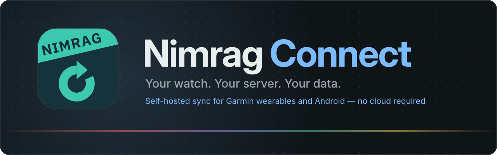
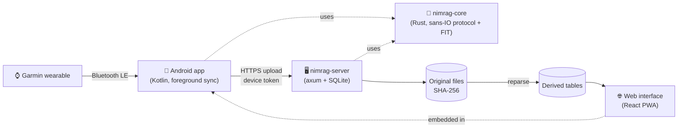

<p align="center">
  
</p>

<p align="center">
  
  
  
  
  
  
</p>

<p align="center">
  <a href="#why">Why</a> ·
  <a href="#how-it-works">How it works</a> ·
  <a href="#roadmap">Roadmap</a> ·
  <a href="#getting-started">Getting started</a> ·
  <a href="#principles">Principles</a> ·
  <a href="#ai-assisted-development">AI-assisted</a> ·
  <a href="docs/protocol/PROTOCOL.md">Protocol notes</a>
</p>

---

**Nimrag Connect** is a self-hosted replacement for the Garmin Connect app and cloud. An Android app talks to your Garmin wearable over Bluetooth LE, pulls every file it records, and sends them to a server you run. The server keeps the originals untouched and turns them into your own dashboards. No account, no cloud, no third party in the middle.

## Why

- **Your data stays yours.** Activities, sleep, heart rate and the rest go from your wrist to your server, and nowhere else.
- **Originals first.** Every file from the watch is stored byte for byte, addressed by its SHA-256. The database is only a view, and you can rebuild it from the files at any time.
- **Nothing made up.** Nimrag Connect shows what the watch measured and computed. If a metric isn't in the files, it says *unavailable* instead of estimating it.
- **Built from evidence.** The Bluetooth protocol was mapped from our own captures and static analysis, and every finding is labelled *seen*, *inferred* or *unknown*.

## Highlights

| | |
| --- | --- |
| ⌚ **Direct watch sync** | Our own implementation of the watch link (multi-link, reliable transport, file transfer). Files are only marked as synced on the watch once the phone has stored them safely. |
| 🗄️ **Content-addressed store** | Idempotent uploads, a SHA-256 file store with sidecars, and `reparse` to rebuild every table from the originals. |
| 🧬 **Lossless FIT decoding** | Keeps every message and field, including unknown and manufacturer-specific ones, with their raw bytes. |
| 📈 **Health and training data** | Activities, laps and GPS tracks, strength sets, all-day heart rate, stress, steps, breathing, SpO₂, sleep, HRV, training load and recovery. |
| 📦 **Bring your history** | Imports a Garmin data export, nested zips and all, through the same path as live uploads. |
| 🔒 **Built to run at home** | A single Rust binary with SQLite, meant to sit behind your own VPN. |

## How it works



One Rust crate, `nimrag-core`, holds the watch protocol and all FIT decoding. It is *sans-IO*: bytes go in, and bytes and events come out. The server links it directly, and the Android app will call it through generated Kotlin bindings, so there is exactly one implementation of the protocol and one of the parsers.

## Roadmap

| | Phase | State |
| --- | --- | --- |
| ✅ | **0. Protocol map:** static analysis and live Bluetooth captures, decoded end to end | Done. Night-sync and fresh-pairing captures still to record. |
| ✅ | **1. Server:** ingest, file store, FIT decoding, parsers, `reparse`, export importer | Done. Gate passed on a full USB copy of a watch. |
| 🚧 | **2. Android sync:** protocol client, Android app, upload queue, companion duties, Garmin device support ported from Gadgetbridge | The protocol client is done and replays every captured session. Porting Gadgetbridge's Garmin work and the Android app are next. |
| ⏳ | **3. Web interface:** Today, activities, sleep, trends, training, calendar and more | Planned. |
| ⏳ | **4. Writing and operations:** workouts to the watch, backups, export, runbook | Planned. |

The full plan, with every stage and its status, is in [`IMPLEMENTATION_PLAN.md`](IMPLEMENTATION_PLAN.md).

## Getting started

Nimrag Connect is not ready for everyday use yet. To build it and run the tests:

```sh
git clone https://github.com/AngelFreak/Nimrag-Connect.git
cd Nimrag-Connect
cargo test --workspace
```

No test needs a watch. Tests that replay real captures run only when the git-ignored `private/` directory is present, and skip otherwise.

Running the server:

```sh
cargo run -p nimrag-server -- token create --data-dir ./data --name upload-script   # a token for scripts and tools (phones get theirs by signing in to the app)
cargo run -p nimrag-server -- serve --data-dir ./data --listen 127.0.0.1:8080
curl -H "Authorization: Bearer <token>" --data-binary @activity.fit \
     "http://127.0.0.1:8080/api/files?source=usb"
```

Importing a Garmin data export:

```sh
cargo run -p nimrag-server -- import-export --data-dir ./data ~/Downloads/garmin-export.zip
```

> [!NOTE]
> FIT field names come from a profile table that you generate locally from your own copy of the Garmin Connect app (see [`tools/fit-profile/`](tools/fit-profile/)). That table is Garmin material, so it is never committed. Without it, everything builds and raw decoding works, but the derived tables (activities, wellness) stay empty. Don't share binaries or images built with a generated profile.

## Repository layout

| Path | What |
| --- | --- |
| [`core/`](core/) | Rust crate: sans-IO watch protocol, protocol client, FIT decoding and parsers |
| [`server/`](server/) | Rust service (axum, SQLite via sqlx): ingest, store, `reparse`, importer |
| [`tools/decode/`](tools/decode/) | CLI that decodes Bluetooth snoop logs, live streams and FIT files |
| [`tools/proto-recover/`](tools/proto-recover/), [`tools/fit-profile/`](tools/fit-profile/) | generators used during protocol work |
| [`docs/protocol/`](docs/protocol/) | the protocol as decoded, with message tables, schemas and open questions |
| [`docs/`](docs/) | architecture and licensing records |

## Principles

1. **No cloud.** No component calls Garmin's servers. The one planned exception, GPS-assist data, will be a setting you can turn off.
2. **Original files are the source of truth.** The database can always be rebuilt from them.
3. **Never invent data.** Prefer values the watch computed. Missing means *unavailable*.
4. **Our own design.** Our own interface, names and layout; no Garmin screens, icons or wording.
5. **Evidence over assumption.** Anything marked *unknown* in the protocol notes gets a capture or a test before it gets code.
6. **No personal data in the repository.** Captures and real files stay in the git-ignored `private/` directory, and committed fixtures use made-up ids.

## Compatibility

Nimrag Connect is built for Android phones and Garmin wearables that use Garmin's multi-link Bluetooth protocol. So far all development and verification has been done against an **Instinct 2**, and a few details, such as the Bluetooth packet size, were measured on that model. Support for other Garmin models is being ported from Gadgetbridge's device catalogue (about 200 models). Until someone syncs one, those models count as *supported per Gadgetbridge, not verified*. Reports from other watches are very welcome.

## AI-assisted development

Nimrag Connect is built with AI coding assistants, openly. The owner decides what gets built and how it should behave. AI does much of the implementation and review. Nothing is committed until it has been checked by tests, an independent review and, where it matters, real data from a real watch.

AI-assisted contributions are welcome. We ask that they are responsible:

- **Own your change.** Understand it, be able to explain it, and stand behind it, whoever or whatever typed it.
- **Prove it.** Tests for new behaviour, and tests that go through the real entry point, not just a unit in isolation. Run the full suite before you open a pull request.
- **Evidence, not plausibility.** AI is good at confident guesses. Protocol and data claims need a capture, a file or a test, and must be labelled *seen*, *inferred* or *unknown*. Never invent values.
- **Respect licences.** Code ported from Gadgetbridge keeps its attribution header and gets a row in [`docs/PORTED.md`](docs/PORTED.md). Don't paste code from projects whose licence isn't compatible with the AGPL, and never commit Garmin profile tables.
- **Keep personal data out.** No real captures, ids, positions or account data in commits, prompts you share or test fixtures.
- **Say how it was made.** Mention AI assistance in your pull request so reviewers know where to look harder.

## Acknowledgements

A big thank you to **[Gadgetbridge](https://codeberg.org/Freeyourgadget/Gadgetbridge)** and everyone who has contributed to it. Gadgetbridge is the free and open-source app that lets people use their wearables without the vendors' cloud, and its years of careful work on Garmin devices are what let Nimrag Connect support Garmin wearables without decoding every model from scratch.

Nimrag Connect ports Gadgetbridge's Garmin work under the AGPL, with each ported file credited in its header and listed in [`docs/PORTED.md`](docs/PORTED.md). Ported behaviour is still checked against our own captures before we call it verified. Gadgetbridge's original copyright stays with its authors. If you can, [support Gadgetbridge on Liberapay](https://liberapay.com/Gadgetbridge/donate) too.

## Licence and disclaimer

Nimrag Connect is free software under the [GNU Affero General Public License v3.0 or later](LICENSE). If you run a modified server for other people, the AGPL asks you to offer them its source. See [`NOTICE`](NOTICE) for attributions.

Nimrag Connect is an independent project and is not affiliated with, endorsed by or supported by Garmin. Garmin, Garmin Connect and Instinct are trademarks of Garmin Ltd. or its subsidiaries, used here only to describe compatibility.

<p align="center"></p>
